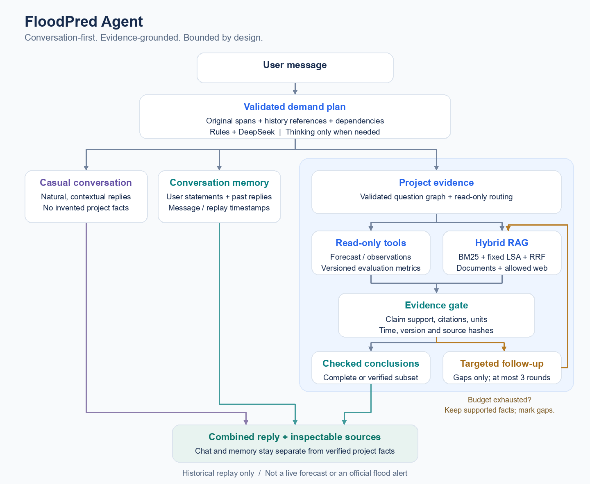

# FloodPred Agent

FloodPred Agent is an **evidence-driven investigation assistant** for House Mill volunteers. It brings forecasting analytics, hybrid RAG, and bounded multi-step reasoning into a single conversational interface, with traceable sources behind each project conclusion.

Built on [FloodPredict](https://github.com/CrazyEpi/CASA0022-Dissertation-FloodPredict), it turns archived predictions and research material into accessible explanations backed by time-aware data access and claim-level evidence checks. The replay demo runs locally without the original cloud server.

> **Research prototype:** This is a historical replay tool, not a live forecast service, official flood alert, or guide for on-site safety decisions.

## Highlights

- **Multi-source intelligence:** combines archived forecasts, observations, evaluation metrics, and research documents.
- **Auditable answers:** preserves original question spans, source locations, versions, and claim-level citations.
- **Controlled autonomy:** investigates evidence gaps within explicit tool, model-call, and time budgets.

## How It Works



[View the vector diagram](assets/how-it-works.svg)

1. **Demand planning.** Rules and optional DeepSeek assistance separate chat, recollection and project requests; only project requests enter the evidence graph.
2. **Dual-path retrieval.** Read-only tools retrieve numbers, while hybrid keyword and semantic search finds relevant documents.
3. **Time-aware replay.** Historical queries exclude observations unavailable at the replay time and clearly label later evaluations.
4. **Evidence checks.** Each conclusion is checked against source passages, versions, hashes, and units before entering the answer.
5. **Targeted follow-ups.** The agent investigates missing evidence within three rounds and fixed tool, model-call, and time budgets.
6. **Traceable answers.** Verified project conclusions are assembled with citations; natural chat remains a separate answer segment, and missing evidence stays explicit.

## Quick Start

From the repository root in Windows PowerShell, using Python 3.12+:

```powershell
py -3.12 -m venv .venv-d4
.\.venv-d4\Scripts\python.exe -m pip install -r requirements.txt
```

Reuse `.venv-d4` if it already exists, then start the bundled replay:

```powershell
$env:FLOODPRED_DATA_MODE = 'demo'
.\.venv-d4\Scripts\python.exe -m streamlit run streamlit_app.py --server.address 127.0.0.1 --server.port 8501
```

Open http://127.0.0.1:8501. Use the replay time `2026-08-03T01:48:00Z` for the bundled example.

The UI and example queries are currently in Chinese. Core replay and document checks work without an API key.

For optional DeepSeek planning, copy [.env.example](.env.example) to `.env` on a new checkout, or edit your existing configuration:

```dotenv
DEEPSEEK_API_KEY=your_deepseek_api_key
```

Enable DeepSeek in the UI; Thinking has a separate switch. Never commit `.env`.

## Example Questions

The Chinese inputs below match the current demo:

| Question | What it checks |
| --- | --- |
| 当时预测峰值是多少？ | Forecast peak, target time, and run ID |
| 本批次 MAE 是多少？ | Evaluation value, version, sample range, and unit |
| 项目内部 Caution 是什么？ | Internal risk rules and their source |
| 你好，预测峰值和 MAE 的联系是什么？ | The difference between one forecast and average evaluation error |

Command-line replay also works without DeepSeek:

```powershell
.\.venv-d4\Scripts\python.exe -X utf8 -m app.investigate_cli "当时预测峰值是多少？"
```

Add `--llm` to use DeepSeek.

The UI uses **Caution** for the level called **Watch** in the original server documents. This is a display alias; source wording is preserved.

## Bounded Web Evidence

Multi-step investigation can now fill public-source gaps from the existing official-flood, House Mill and project-research host lists. The web UI enables “允许联网补查” by default; it runs only for missing eligible evidence. Python/CLI remain offline unless `allow_web=True` / `--allow-web` is supplied. The single-pass UI option remains local.

```powershell
.\.venv-d4\Scripts\python.exe -X utf8 -m app.investigate_cli "项目内部 Caution 和英国官方预警有什么区别？" --allow-web
```

Registered source URLs work without a search account. Optional Brave search uses `BRAVE_SEARCH_API_KEY`; missing search credentials do not block direct reading. Public search uses public-only templates. HTTPS host/IP/TLS restrictions, response limits and blocked redirects remain in place. Search snippets are candidates, never answer evidence.

Fetched HTML snapshots preserve source text and dates, and are checked again before answering and when resuming. Official definitions use bounded Chinese statements; House Mill and research summaries quote selected original paragraphs rather than accept invented model prose. Current pages cannot prove past availability. Definition comparisons can use explicitly labelled derivations; causal and hardware-inheritance claims still require direct evidence.

See [web evidence, failure examples and demos](docs/15_web_evidence_and_demo.md). The independent `app.web_cli demo --allow-web` still previews raw tools only.

## Tests

Run the offline regression tests:

```powershell
.\.venv-d4\Scripts\python.exe -X utf8 -m unittest discover -s tests -q
```

The offline suite covers routing, source integrity, time leakage, partial answers, budgets, web restrictions, and LangGraph migration parity. The migration tests retain a frozen pre-migration executor under `tests/support/` and compare evidence, outcomes, stopping reasons, and call counts. See the [current web-integration report](reports/web_answer_integration_2026-10-28.md) for current results and the migration report for historical parity results; these are not an open-ended accuracy or security guarantee.

Run the graph-specific checks separately:

```powershell
.\.venv-d4\Scripts\python.exe -X utf8 -m unittest tests.test_investigation_graph -v
```

See the [web-tool report](reports/web_step1_2_2026-10-05.md) and [evidence-check report](reports/P2_step3_4_evidence_2026-10-03.md) for detailed results.

## Repository Structure

```text
FloodPred-Agent/
|-- app/                 Planning, retrieval, evidence checks, and read-only tools
|-- knowledge/           Curated project and research excerpts
|-- demo_data/           Small replay dataset and evaluation snapshots
|-- docs/                Design, source, and security notes
|-- tests/               Offline regression tests
|-- reports/             Evaluation results and development reports
|-- streamlit_app.py     Demo interface
|-- requirements.txt     Python dependencies
`-- .env.example         Optional API configuration
```

The stack uses Python, Streamlit, Pydantic, NumPy, SQLite, LangGraph **1.2.18**, and the optional DeepSeek API. `run_investigation()` uses a sequential LangGraph workflow for first evidence, targeted follow-ups, evidence checks, finalization, and audit. Existing tools, hybrid retrieval, and the direct DeepSeek client remain in place. The full LangChain package and an external vector database are not required; LangGraph's necessary dependencies are installed by `requirements.txt`, with resolved additions pinned in `requirements_langgraph.lock.txt`.

The ordinary graph caches topology only; evidence, clients, and budgets are per request. Optional SQLite checkpoints now support cross-process resume with saved budgets and time scope. Node-result journaling reuses completed work; an interrupted node with an unknown call outcome stops conservatively instead of issuing the call again. New investigations use a 120-second cooperative deadline and a 40-second model-request cap; saved older investigations retain their original limits. Downtime counts toward persisted deadlines. Parallel tools and automatic node retries remain disabled. External LangSmith tracing is disabled for investigation execution, including when enabled in the host environment.

## Web display and debug mode

The sidebar “调试模式” toggle is off by default. Normal mode shows only “回答” and “证据”: answers use friendly source numbers, with source titles, original excerpts and versions. Internal claim/citation IDs, forecast run IDs, hashes, full paths and retrieval details appear only in debug mode. Debug adds “运行细节”, including the original answer, citation mapping, trace, question graph and available model diagnostics. Thinking still independently controls the existing DeepSeek request; its default is unchanged.

Repeated product disclaimers are omitted from the displayed answer; source originals, evidence gaps and actual failures remain available. Raw answers are preserved in debug mode. For timeout settings and acceleration options, see [service operations](docs/06_local_service_operations.md).

The UI now keeps multi-turn chat history in a separate local SQLite database. Switching debug mode rerenders the saved answer without another investigation or model call. The network toggle applies to the next submission. Failed submissions do not display an old risk card as a new answer.

## Conversational Chat

The web UI now splits a message into **individual needs**: casual conversation, recollection, and project evidence. A single turn can use all three lanes. Project answers still pass through the existing read-only tools and evidence gate; a chat reply cannot supply missing forecast facts.

- Bottom-pinned input, scrollable messages, and older-history pagination (30 turns).
- Replay time and model options live in the sidebar. “复杂问题允许深度思考” enables Thinking only for complex planning, not routine replies or claim ordering.
- Recent eight exchanges plus up to six relevant older turns provide context. Older request summaries retain provenance; personal information stays within the authorized conversation.
- Asking what was said before reads a labelled historical record. Asking to query again retrieves fresh evidence.
- Missing information blocks the affected need, not the whole mixed request. Debug mode shows demand coverage, historical references, evidence states and call timings.
- Public-document BM25 statistics and fixed LSA projections are cached by content in a bounded in-process index. Source snapshots are request-local and re-read at final verification.

Try these in one conversation:

1. `昨天我吃了鸡肉`
2. `我昨天吃了什么？当时预测峰值是多少？`
3. `上一次查询的时间是多少？项目内部 Warning 是什么？`
4. `这个时间点的预测水位是多少？` — asks for a target time rather than substituting a peak.

Enable DeepSeek for natural chat. Offline mode supports deterministic recollection and project tools, with explicit fallback messages. Provider formatting failures are not treated as successful understanding.

Conversations use `state/conversations.sqlite3`, separate from evidence and investigation checkpoints. Sidebar recovery codes authorize one conversation; keep them private. Restoring does not execute tools. Clearing removes conversation-derived memory, not shared expression-preference profiles. User messages are stored locally; do not paste secrets. Bind this local prototype to `127.0.0.1`.

The web entrypoint is `app.dialogue.submit_dialogue`; the older `conversation.submit_turn` remains compatible for legacy callers. The new entrypoint shares a six-model-call / 120-second cooperative budget across lanes. Context uses a conservative byte bound (effective maximum 65,536, reserving 8,192 for instructions/output), not billing-token counts. Two different replay times in one message currently require separate queries.

### Test and benchmark

```powershell
.\.venv-d4\Scripts\python.exe -X utf8 -m unittest tests.test_dialogue tests.test_conversation_ui -q
.\.venv-d4\Scripts\python.exe -X utf8 scripts/evaluate_dialogue.py
# Optional: sends only three synthetic messages to DeepSeek
.\.venv-d4\Scripts\python.exe -X utf8 scripts/evaluate_dialogue.py --live
```

See the [implementation report](reports/chat_mixed_2026-10-30.md), [live samples](reports/dialogue_live.json), and [offline microbenchmark](reports/dialogue_offline.json). Small local ranking measurements are not end-to-end latency or production accuracy claims.

Stack: **Python, Streamlit, DeepSeek JSON API, LangGraph, Pydantic, SQLite, NumPy, BM25 + fixed LSA + RRF**. No new environment or external vector database is required.

## Local checkpoints and resume

The web UI uses ordinary investigations. Its chat recovery controls restore conversation history only; existing saved investigation executions remain available through the CLI. Run the two-process offline demo:

```powershell
$env:FLOODPRED_DATA_MODE = 'demo'
.\.venv-d4\Scripts\python.exe -X utf8 -m app.checkpoint_cli demo
.\.venv-d4\Scripts\python.exe -X utf8 -m unittest tests.test_checkpoints -v
```

The default state database is `state/investigations.sqlite3`, separate from evidence databases and ignored by Git. It stores question/evidence snapshots, not model clients, API keys, or raw reasoning. Resume codes authorize access to one local investigation. Resume works at saved node boundaries, not arbitrary lines of code. See [checkpoint operations and testing](docs/14_checkpoints_and_demo.md) and the [checkpoint report](reports/checkpoints_and_demo_2026-10-28.md) for exact behavior, manual tests, and validated resume wording for a CV.

## Scope

- A local research MVP with curated evidence rules, not a general-purpose fact checker or production service.
- Project forecasts and observations remain historical replay; public pages reflect their fetched context. The deployment evaluation contained no observed threshold-crossing flood event, so live event detection remains unverified.
- Public web evidence is limited to registered topics/hosts and readable HTML. Unavailable sources, unsupported attributes or unclear dates produce partial answers; this is not a general web agent.

The bundled dataset is a small demonstration subset. Check [data provenance](demo_data/PROVENANCE.md) and usage rights before redistribution. Keep API keys, local backups, and request logs out of version control.

Further reading: [architecture](docs/08_architecture.md), [migration contract](docs/13_langgraph_migration_contract.md), [checkpoints](docs/14_checkpoints_and_demo.md), [security](docs/09_security.md), and [House Mill sources](docs/12_housemill_context.md).
