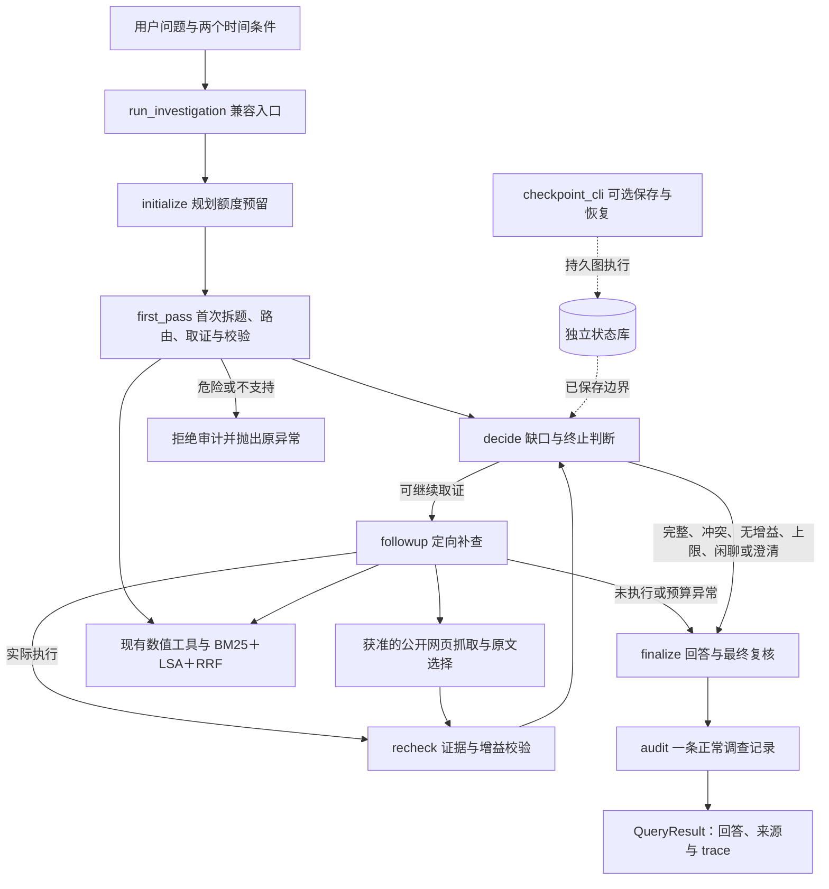

# 架构、数据流与信任边界

更新：2026-10-29（Asia/Hong_Kong）。多步调查入口使用 LangGraph 1.2.18，并可选开启 SQLite 检查点与节点边界恢复；原有只读工具、混合检索、证据校验和 DeepSeek 客户端继续复用。

## 模块职责与兼容入口

依赖方向：`investigation` → `investigation_graph` → `investigation_core` → 原路由、检索、证据与只读工具。core 不依赖兼容入口或图。`run_investigation()` 保留原参数、客户端／时钟注入、`QueryResult` 返回及异常约定，新增 `allow_web=False`。新调查总预算为 120 秒、单次模型请求上限为 40 秒；旧持久调查沿用已保存的限制。

`run_query()` 仍是单轮拆题、路由和取证接口；首次图节点调用它并设置 `generate_answer=False`、`audit_log=None`，避免重复项目回答和审计。Streamlit 原有单轮选项及单轮 CLI 继续可用，多步调查和调查 CLI 使用 LangGraph 入口；没有新增框架选择开关或生产旧实现回退。

`question_graph.py` 表达用户子问题与依赖；`investigation_graph.py` 表达执行节点与条件边。冻结旧调查代码仅保留在测试支持目录，不作为生产依赖。编译图只缓存拓扑，每个请求单独创建预算、客户端和状态。节点返回替换更新，修改结果前复制 `QueryResult`，不对候选或 trace 使用自动追加 reducer。

## 网页展示边界

网页只调用普通 `run_investigation()` 或单轮 `run_query()`；保存、恢复和恢复码入口已移除，CLI 与后端检查点能力继续保留，已有状态库不删除。侧边栏“调试模式”默认关闭，独立于 Thinking 请求开关。

`app/presentation.py::ResultPresentation` 是无 I/O 的纯展示层：按已核验引用首次出现顺序分配来源编号，同文件同版本的段落共用编号；只替换当前结果中已知的引用与预测批次元数据，不全局删除十六进制内容。当前结果新增默认空的 `web_evidence` 和 `web_runs`，分别保存不可变网页快照与执行记录；旧检查点的已知缺失字段按空值补齐，未知字段仍拒绝。

普通模式仅渲染“回答／证据”，显示数值、日期、单位、缺口、来源标题、版本与原文。调试模式增加“运行细节”，展示原始回答、引用映射、运行 JSON、问题图、trace 及已有模型诊断，并开放证据的技术定位字段；不展示密钥、请求头或 `.env`。最近一次结果保存在会话中，切换仅重新展示，不执行调查；新问题失败前先清空旧结果，避免旧答案冒充新答案。会话缓存不提供跨进程恢复。展示层也省略固定的内部／官方及非实时免责声明，保留证据缺口、实际错误与原始资料；不改变后台结论或提示词。超时配置与后续提速选项见 [服务说明](06_local_service_operations.md)。

## 数据与证据信任边界

危险意图校验先于实际数据工具和模型规划调用；没有任意 SQL 或写数据工具。原先客户端构造及规划额度预留的顺序保留。`archive.py` 与 `replay.py` 使用 SQLite 只读、immutable 连接及 `query_only`；MAE 来自固定 SHA-256 的评估快照。

预测回放要求生成和入库不晚于 `as_of_utc`，且回放时间不超过有效期；观测同时检查观测和入库时间。预测的未来目标时间允许晚于回放时间。文档截止日期独立传递，不等价于历史可见性证明；补查不放宽任一时间条件。

检索保留原话和受约束改写，经来源过滤后进行 BM25／本地 TF-IDF-LSA 及加权 RRF。候选分数不授权事实。证据门核对来源、版本、哈希、引文、数字、单位及支持契约；定义比较可以将已支持的两端定义按预先限定维度作显式推导；因果、设备相同或技术继承仍不能只凭两端相关材料得出。DeepSeek 只能选择已核验结论和允许表达，整理前后复核来源。资料不足时保留局部结论或回退，来源冲突由程序显示，不由模型裁决。

## 执行、预算与持久化边界

默认最多 3 轮取证（首次＋最多 2 轮补查）、8 次工具调用、4 次模型调用、120 秒协作式预算；单次模型请求最多 40 秒并受剩余总时间约束。计数、限制与时钟由唯一 live budget 持有，失败后不退还预留额度。条件边不额外读取时钟；只在所有预算相关操作结束后生成观察快照。总预算不是进程级硬截止，也不覆盖所有本地操作。

图的 `recursion_limit=64` 是结构故障保护，不替代业务轮次。没有节点自动重试或工具并行。普通模式仍无检查点；可选持久模式使用独立 SQLite、同步节点检查点、已完成节点结果记录及持久预算。恢复保留原问题、两个时间条件和明确的数据路径，总时限包含停机时间。未知调用结果不自动重发，只整理前一保存边界的核验部分。

模型客户端、预算对象和连接通过运行上下文注入，不序列化。持久模式另存原请求、限制、绝对截止时间、累计次数及数据路径配置；评估文件路径也显式传入首次查询和补查，避免恢复进程的数据模式不同导致混用。独立状态类型模块只导入标准库；JSON 编码器用版本和类型白名单保存自定义对象，拒绝不兼容字段，不使用 pickle。

外部 LangSmith tracing 在调用图时显式关闭，宿主开启 tracing 也不导出问题和证据。普通模式的 `logs/requests.jsonl` 记录元数据及安全 trace；持久模式的 `state/investigations.sqlite3` 另存完整问题和证据快照，并以每个 execution 唯一的审计行记录最终摘要。客户端、密钥及原始模型思维链均不写入检查点；状态目录被 Git 忽略。

普通调查保持原有单条 JSONL 审计及正常／拒绝写入失败差异；持久调查使用独立状态库的幂等审计 upsert，避免节点重执行重复追加。随机执行 ID 加随机恢复凭证隔离调查，操作系统锁防止同一调查并发恢复。已完成调查仅返回保存结果；未完成调查恢复前复核版本及相关来源，变化时撤下失效部分并停止补查。

备份仍保留，但不重复扫描全项目或所有历史备份哈希。恢复一致性使用文件元数据和知识版本发现变化，再执行必要的精确证据校验；来源完整性及恢复凭证校验继续保留。

## 可追溯字段与验证

结果及审计继续保留请求 ID、UTC、问题 SHA-256、时间条件、路由、轮次、调用次数、停止原因、数据批次、引用与错误计数。检索 trace 保存查询哈希，不保存查询原文；图节点名称不重复追加进既有业务 trace。

完整行为、覆盖缺口与类型所有权见 [迁移契约](13_langgraph_migration_contract.md)；持久化语义和测试命令见 [恢复指南](14_checkpoints_and_demo.md)，实际结果见 [第 10–11 步报告](../reports/checkpoints_and_demo_2026-10-28.md)。

## 公开网页证据接入

`web_evidence.py` 在原 `followup` 内执行，图拓扑仍由现有条件边控制。每轮可以同时补本地及公开网页，统一按一轮计数，再经 `assess_evidence()` 和最终引用复核。联网开启时，没有多个可排序的本地动作就不调用缺口排序模型。

网络最多 4 次请求／20 秒，同时扣减共享工具预算；同调查相同 URL 不重复抓取。直连登记来源优先，真实页面的一层链接和可选 Brave 搜索补充候选；不发送完整混合问题，不允许模型添加域名或任意 URL。完整 HTML 与提取段落保存在冻结快照，网页证据不冒充本地目录项；最终核对快照内容、定位、引用、来源范围及时间条件。研究及活动信息采取原文摘录，模型只选择索引。

公开问题的待取证状态不能先当闲聊生成无依据回复；近期活动和研究需要原文明确日期，抓取日期不等于发表／活动日期。历史问题和早于当前抓取的文档截止时间不能由当前网页填补。当前“官方如何定义”与查询“当前是否生效”区别处理；不查询实时生效警报或执行发布操作。

网页默认允许缺口联网，单轮及 API／CLI 默认离线。恢复保留网页快照及已扣预算，不自动刷新网页；网络节点结果未知仍停止重发，审计保持唯一。当前演示与验收见 [在线取证指南](15_web_evidence_and_demo.md)。
